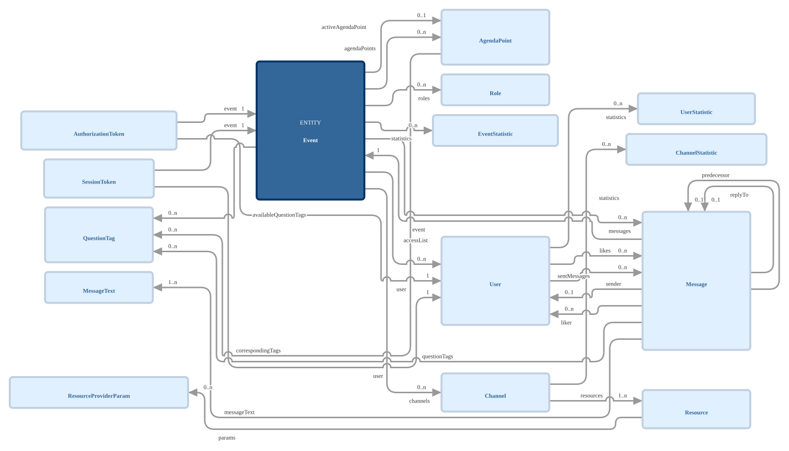
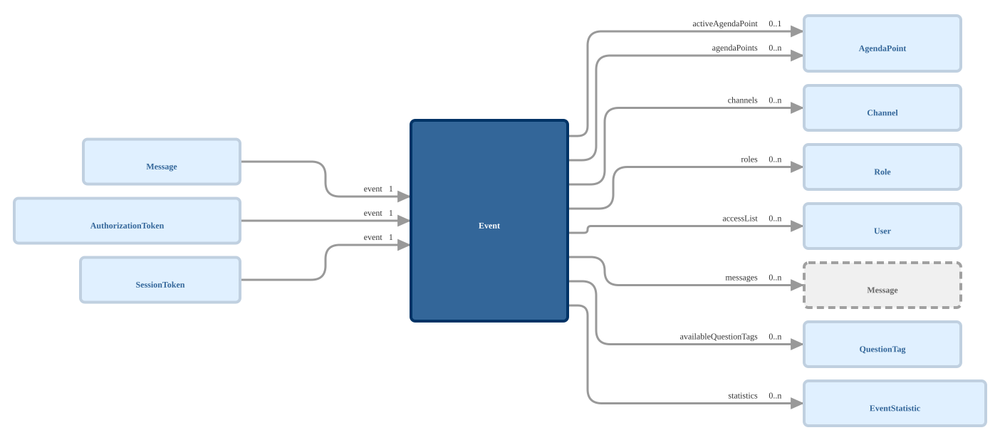
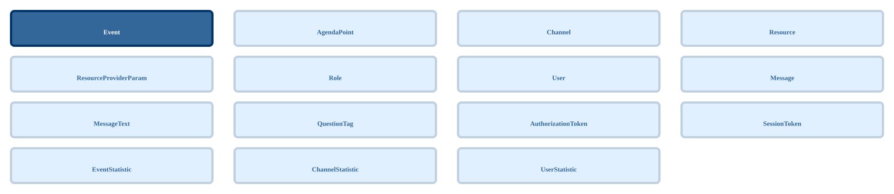
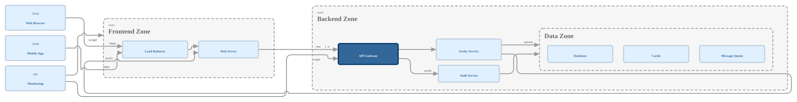
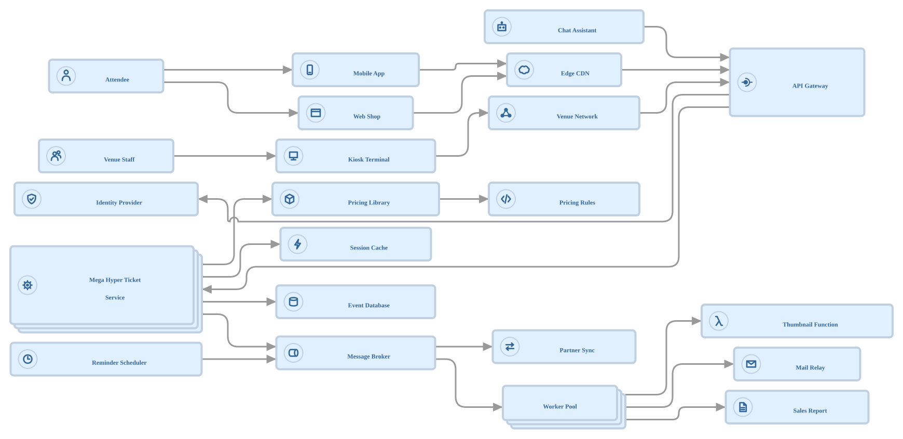
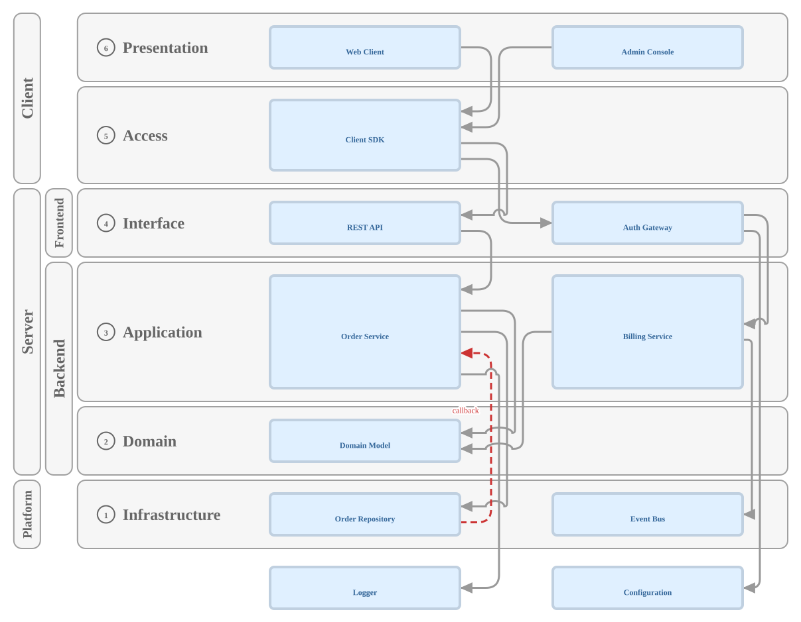
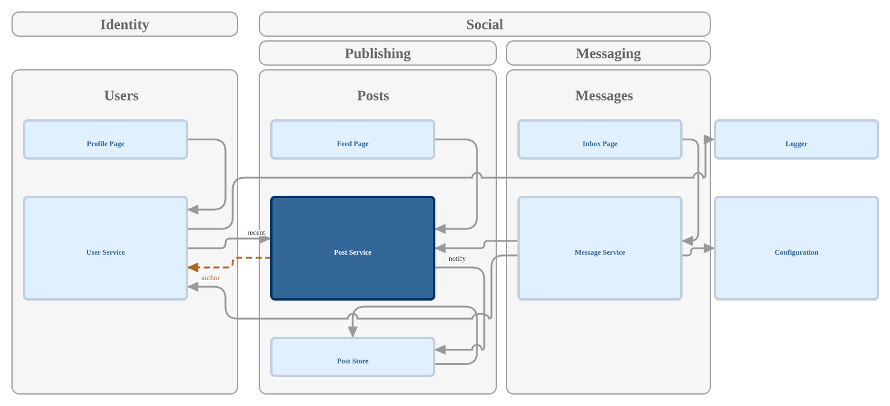
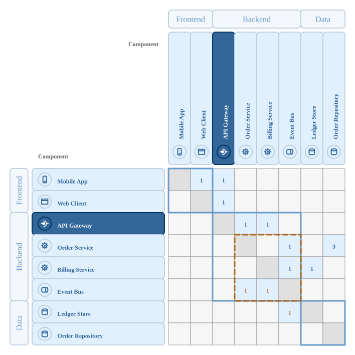
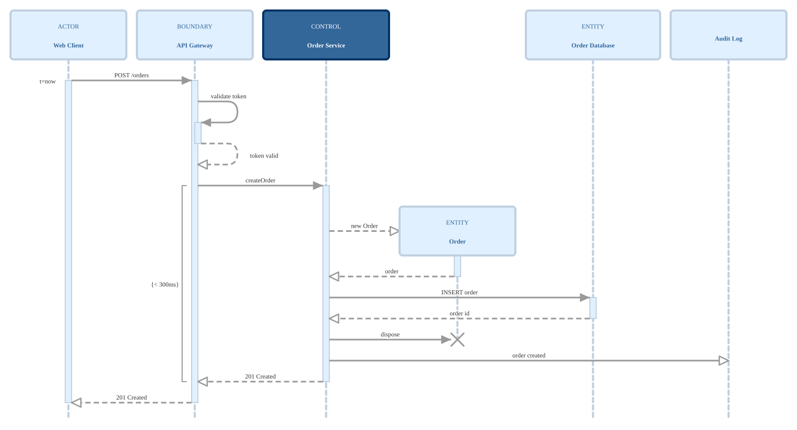

Gradia
======

**Object Graph Diagram Rendering**

<p/>


[](https://github.com/rse)
[](https://github.com/rse)

About
-----

**Gradia** is a small API and CLI for rendering directed graphs,
described in a concise textual input language, as SVG diagrams. Seven
diagram types are supported which fit the scenario of visualizing object
graphs:

- `graph`: a loosely grid-snapped layered layout of the whole graph,
  based on the Dagre algorithm of [@antv/layout](https://github.com/antvis/layout).
- `hub`: a hub graph, placing one primary hub node between its input and
  output nodes.
- `grid`: a compact grid of tiles for an edge-less graph.
- `layer`: a layered architecture, stacking its layers as bands and
  marking the edges pointing upwards against the layering.
- `slice`: a sliced architecture, lining up its slices as bands and
  marking the edges pointing backwards to close a cycle between slices.
- `matrix`: a dependency structure matrix, counting the edges between
  its rows and columns and outlining its cycles.
- `sequence`: a sequence diagram of participants and their messages.

Examples
--------

Here are examples of the graph diagram renderings:

- [sample-graph-regular](smp/sample-graph-regular.txt):

  

- [sample-hub-regular](smp/sample-hub-regular.txt):

  

- [sample-grid-regular](smp/sample-grid-regular.txt):

  

- [sample-graph-container](smp/sample-graph-container.txt) (nested containers):

  

- [sample-graph-badges](smp/sample-graph-badges.txt) (node badges and multiple nodes):

  

- [sample-layer-regular](smp/sample-layer-regular.txt) (layered architecture):

  

- [sample-slice-regular](smp/sample-slice-regular.txt) (sliced architecture):

  

- [sample-matrix-full](smp/sample-matrix-full.txt) (dependency structure matrix):

  

- [sample-sequence-regular](smp/sample-sequence-regular.txt) (sequence diagram):

  

Playground
----------

See [playground.html](smp/playground.html) for a demo playground.


Installation
------------

```sh
$ npm install @rse/gradia
```

Usage
-----

```sh
$ gradia [-t graph|hub|grid|layer|slice|matrix|sequence] [-f <format>] [-c <name>=<value>] -o <file>.svg <graph>.txt
```

The diagram type is selected with the `-t` command-line option or, when
this is absent, by the `#type` directive inside the input, and defaults
to `graph`.

The output format is `svg:standalone` (a standalone SVG/XML document,
the default), `svg:embedded` (the SVG without the `<?xml?>` declaration,
for direct embedding into HTML), `url:xml` (a `data:image/svg+xml` URL
with URL-encoded XML), or `url:base64` (a `data:image/svg+xml` URL with
Base64-encoded XML).

MCP Service
-----------

```sh
$ gradia --mcp [-t graph|hub|grid|layer|slice|matrix|sequence] [-f <format>] [-c <name>=<value>]
```

With the `-m`/`--mcp` option, **Gradia** instead runs as a [Model Context
Protocol](https://modelcontextprotocol.io/) (MCP) service on stdio,
exposing a single tool `gradia_render` which renders a graph description
into an SVG diagram. The tool takes the arguments `input` (the graph
description), `type`, `format`, and `config` (an object of rendering
options), and returns the rendered SVG document or data URL as its text
result. Its description carries the entire input language grammar, so
an AI agent can author graph descriptions without further context. The
command-line options `--type`, `--format`, and `--config` act as the
defaults underlying the tool call arguments.

As the tool call arguments are treated as untrusted, the `config`
argument rejects the option `font-embed` and a `font-family` value
pointing to a WOFF2 file. Both remain available through the
(trusted) command-line options of the service.

Configure the service in an MCP client with:

```json
{
    "mcpServers": {
        "gradia": {
            "command": "npx",
            "args": [ "-y", "@rse/gradia", "--mcp" ]
        }
    }
}
```

Input Syntax
------------

The input is a plain-text graph description: one node/edge chain per
line, plus optional comments and rendering directives.

### Grammar

The following BNF grammar describes the input syntax. Non-terminals are
written as `<name>`, terminals as `"..."`, optional parts as `[ ... ]`,
repeatable parts as `{ ... }` (zero or more times), and alternatives are
separated by `|`.

```bnf
<graph>          ::= { <statement> | <newline> }
<statement>      ::= <node> { <edge> <node> [ <edge-attrs> ] } ( <newline> | <eof> )
<node>           ::= <atom> [ ":" <atom> ] [ <attributes> ]
<attributes>     ::= "[" <attribute> { "," <attribute> } "]"
<edge-attrs>     ::= "{" <attribute> { "," <attribute> } "}"
<attribute>      ::= <atom> ":" <atom>
<edge>           ::= "--" [ "(" <edge-name> ")" "--" ] ">" [ "[" <edge-arity> "]" ]
<edge-name>      ::= <string> | <name-word>
<edge-arity>     ::= <string> | <arity-word>
<atom>           ::= <bareword> | <string>
<bareword>       ::= <bareword-char> { <bareword-char> }
<bareword-char>  ::= <char> - ( <whitespace> | "[" | "]" | "(" | ")" | "{" | "}" | "," | ":" | "\"" | ">" | "#" )
<name-word>      ::= <name-char> { <name-char> }
<name-char>      ::= <char> - ( <whitespace> | "(" | ")" | "\"" )
<arity-word>     ::= <arity-char> { <arity-char> }
<arity-char>     ::= <char> - ( <whitespace> | "[" | "]" | "\"" )
<string>         ::= "\"" { <string-char> } "\""
<string-char>    ::= ( <char> - ( "\"" | "\\" | <newline> ) ) | ( "\\" ( <char> - <newline> ) )
<comment>        ::= "#" { <char> - <newline> }
<directive>      ::= "#config" <whitespace> { <whitespace> } <option> <whitespace> { <whitespace> } ( <string> | <word> )
                   | "#type" <whitespace> { <whitespace> } <type>
<option>         ::= <lowercase-letter> { <lowercase-letter> | <digit> | "-" }
<type>           ::= "graph" | "hub" | "grid" | "layer" | "slice" | "matrix" | "sequence"
<word>           ::= <char> - <whitespace> { <char> - <whitespace> }
<newline>        ::= "\n"
<whitespace>     ::= " " | "\t" | "\r"
```

### Lexical Rules

- A `<bareword>` must not contain the character sequence `--` at any
  position, as `--` always starts an edge operator.

- An `<edge>` is a single lexical token: no whitespace and no comment is
  allowed anywhere inside it, especially not between `>` and `[`.

- Whitespace (except `<newline>`) is insignificant between all other
  tokens and never part of a token.

- A `<newline>` terminates a `<statement>`: statements cannot span
  multiple lines.

- A `<comment>` starts at an unquoted `#` and extends to the end of the
  line. Inside a `<string>`, `#` is an ordinary character.

- A `<string>` cannot span lines. Inside it, `\` escapes the following
  character (especially `\"` and `\\`).

- A `<directive>` is a `<comment>` which occupies its entire line and
  starts with the keyword `#config` or `#type`. For `#config`, the
  `<option>` has to be one of the recognized rendering options (see
  below). All other comments are ignored.

### Semantic Rules

- In `<node>`, the first `<atom>` is the node id and the optional
  `<atom>` after `:` is the displayed node label. Without a label, the
  id is displayed.

- A node can be referenced multiple times. All references address the
  same node and merge their label and attributes into it, with later
  values overriding earlier ones for the same attribute key.

- A node id must not contain the NUL character (U+0000), as it is
  reserved for internal use: the diagram type `hub`, and every diagram
  containing a container, reject such an id with an error.

- Nodes which are never part of an `<edge>` are rendered free-standing.

- In a chain `a --> b --> c`, each `<edge>` connects its immediately
  preceding and following node, i.e., the chain is equivalent to the
  two statements `a --> b` and `b --> c`.

- The `<edge-name>` is rendered as the label of the edge and the
  `<edge-arity>` as its cardinality label.

- The `<edge-attrs>` following a node belong to the `<edge>` leading
  into that node, i.e., in `a --> b { kind: async } --> c` they belong
  to the edge `a --> b`. The recognized keys are `kind`, with the values
  `sync` (the default), `async`, `return`, `create`, and `destroy`, plus
  `duration` and `time`, with arbitrary texts. Only the diagram type
  `sequence` renders them (see below), while the other diagram types
  reject a kind other than `sync`, as well as a `duration` or `time`,
  with an error. Any other key is rejected with an error, too.

- Ten attribute keys are reserved and consumed by the renderer instead
  of being displayed as a regular `<key>: <val>` line:

    - `url: <url>` renders the node box as a hyperlink. Only relative URLs
      and the schemes `http`, `https`, and `mailto` are honored; any other
      URL is silently dropped and the node box then simply stays unlinked,

    - `type: <name>` renders `<name>` as a smaller text above the node
      label inside the node box,

    - `primary: true` renders the node in the primary node colors
      (and, for diagram type `hub`, marks the single central hub node),

    - `group: <name>` places the node into the surrounding group box
      `<name>` (every group being laid out as a diagram of its own, the
      groups stacked, and no edge running between them),

    - `cluster: <path>` places the node into the nested clusters of the
      `/`-separated path `<path>` within the one diagram, crossed freely
      by the edges (for diagram type `matrix`: partitions of its rows and
      columns, for diagram type `layer`: groups of its layers, for
      diagram type `slice`: groups of its slices), while the other diagram
      types ignore it,

    - `parent: <id>` nests the node into the container node `<id>` (a
      node which is implicitly declared if never referenced otherwise),

    - `container: <type>` marks the node as a container whose members
      are laid out with the diagram type `<type>` (`graph`, `hub`, or
      `grid`), even if it has no members at all,

    - `order: <number>` places the node explicitly (see below),

    - `badge: <icon>` draws a round badge with an icon inside the node
      box, vertically centered at its left end, with the box widened to
      keep its text clear of it: `person`, `team` (two persons),
      `bot` (a robot head), `device` (a monitor), `mobile` (a phone),
      `browser` (a window), `service` (a gear), `function` (a lambda),
      `api` (a ball and socket), `code` (angle brackets with a slash),
      `package` (a cube), `database` (an upright cylinder), `cache` (a
      lightning bolt), `queue` (a lying cylinder), `document` (a page),
      `mail` (an envelope), `communication` (two-way arrows), `clock`,
      `security` (a shield), `cloud`, or `network` (three linked nodes),
      an unknown icon being ignored,

    - `multiple: true` draws the node box as several instances: the
      front box with two copies behind it, offset towards the
      bottom-right.

  Both `badge` and `multiple` are ignored on a container node.
  Additionally, the diagram types `layer` and `slice` consume the
  attribute `layer: <name>` and `slice: <name>`, respectively (see
  below), while all other diagram types display them as regular lines.

- A `graph` (a `graph` container level, too) with at least one node
  carrying an `order` attribute is laid out in that explicit order
  instead of by the layered algorithm: the distinct order values become
  the rows, top-down in ascending order, the nodes of one value fill
  their row left-to-right in declaration order (wrapped into further
  rows beyond `graph-columns-max` nodes), and the nodes without an order
  follow in the trailing rows. A `grid` places its tiles in the order of
  the attribute, too, the tiles without one trailing. An invalid value
  is ignored.

- A node cannot be a member of more than one group. As soon as at least
  one node carries a `group` attribute, all nodes without one implicitly
  belong to the group `default`, and every edge has to stay within a
  single group. A nested node belongs to the group of its outermost
  container.

- A node referenced as the `parent` of another node is a container: it
  is rendered as a dashed grey box surrounding its members instead of as
  a node box, with its label, `type`, and `url` in the box head (its
  remaining attributes are not rendered). Containers nest to any depth,
  but a node cannot be a member of more than one container, and cannot
  be nested into itself.

- The members of a container are laid out as a diagram of their own,
  with the diagram type of the enclosing level unless overridden by
  `container: <type>`, and the container then takes part in the layout
  of the enclosing level as a single box. Edges may connect any two
  nodes, across container boundaries and to container nodes themselves,
  except a container with one of its own members. An edge crossing the
  boundary of a container laid out as `graph` is routed through the box
  border to the inner node (entering on the west and leaving on the east
  side, and where other nodes lie between the inner node and the border,
  around them through the gutter below, passing the border at the
  height of that gutter), while an edge crossing the boundary of a
  container laid out as `hub` or `grid` ends at the box border instead.

- All remaining attributes are displayed as `<key>: <val>` lines inside
  the node box.

### Diagram Types

#### Common Rules

- **Groups and containers**: the groups of a grouped graph, and the
  members of every container, are laid out individually with the
  selected (or, for a container, the annotated) diagram type. Hence the
  constraints of a diagram type apply to every single group and
  container level.

- **Boundary-crossing edges**: an edge crossing a container boundary
  counts at the level it is lifted to. The boundary-crossing edges of a
  `graph` container additionally count inside it, from the boundary to
  the inner node.

- **Containers**: only the diagram types `graph`, `hub`, and `grid` lay
  out the members of a container. The diagram types `layer`, `slice`,
  `matrix`, and `sequence` reject the input with an error as soon as
  the graph contains a container.

- **Violations**: the diagram types `layer`, `slice`, and `matrix` mark
  their violations in the `color-mark-violation` color, unless the
  option `mark-violation` is `false`.

#### Diagram Type `graph`

The diagram type `graph` imposes no constraints on the topology: it
accepts self-loops and free-standing nodes alike, and hence is the safe
choice whenever the topology is not known to fit `hub` or `grid`.

#### Diagram Type `hub`

The diagram type `hub` rejects the input with an error unless all of the
following conditions hold:

- Exactly one node carries the attribute `primary: true`. Hence every
  group and every `hub` container needs its own primary node.

- Every edge either points to or originates from that primary node. An
  edge between two non-primary nodes is rejected.

- Every non-primary node is an input or an output of the primary node,
  i.e., no node is free-standing.

Two special placements extend the layout:

- **Ghost**: a node which is both an input and an output of the primary
  node is placed twice, once in the input column and once in the output
  column. The second placement is rendered as a dashed "ghost" box,
  colored by the `color-node-ghost-*` options.

- **Self**: a self-loop on the primary node is unrolled: the primary
  node is placed a second time on top of the output column, as the
  target of the self-loop. This second placement is rendered as a dashed
  "self" box, colored by the (darker grey) `color-node-self-*` options.

#### Diagram Type `grid`

The diagram type `grid` rejects the input with an error as soon as the
graph contains at least one edge.

#### Diagram Type `layer`

The diagram type `layer` lays out a layered architecture:

- **Layers**: the attribute `layer: <name>` assigns a node to a layer.
  The layers stack top-down in the order of their first appearance, as
  bands spanning the whole diagram (colored by the `color-container-*`
  options, the layer name left of its nodes).

- **Nodes**: the nodes of a layer fill its band left-to-right (wrapped
  beyond `graph-columns-max` nodes), while the nodes without a layer
  trail outside of any band. The layers determine the order of the
  rows, so an `order` attribute of a node is ignored.

- **Boxes**: all node boxes take the width of the widest one and the
  boxes of a layer the height of the highest one, and the boxes of a
  layer stay aligned in its band.

- **Violations**: an edge pointing from a lower layer to a higher one,
  i.e., against the layering, is drawn dashed in the
  `color-mark-violation` color.

- **Clusters**: the attribute `cluster: <path>` assigns the layer of a
  node to nested clusters (`/`-separated, outermost first, e.g.
  `Server/Broker`). They are drawn as columns left of the bands,
  spanning the bands of their layers, with their names running upwards.
  The layers of a cluster are kept together, all nodes of a layer have
  to name the same path (otherwise the input is rejected with an
  error), and the edges may freely cross the clusters.

- **Numbering**: the boolean option `layer-numbered` numbers the layers
  bottom-up (by default, as every layer builds on the ones below it).

#### Diagram Type `slice`

The diagram type `slice` is the companion of the diagram type `layer`
and lays out a sliced architecture:

- **Slices**: the attribute `slice: <name>` assigns a node to a slice.
  The slices line up left-to-right in the order of their first
  appearance, as bands spanning the whole diagram (colored by the
  `color-container-*` options, the slice name above its nodes), and are
  never wrapped, regardless of `graph-columns-max`.

- **Nodes**: the nodes of a slice stack top-down in its band in
  declaration order (never wrapped), while the nodes without a slice
  trail outside of any band. The slices determine the order of the
  columns, so an `order` attribute of a node is ignored.

- **Boxes**: all node boxes take the width of the widest one and the
  boxes of a row the height of the highest one. The channels between
  the bands widen (within a few re-layouts) until the edges within a
  slice stay inside its band.

- **Violations**: an edge pointing from a right slice back to a left
  one is drawn dashed in the `color-mark-violation` color if it closes
  a direct cycle, i.e., if any edge points from that left slice to the
  right one. Transitive cycles are not checked.

- **Clusters**: the attribute `cluster: <path>` assigns the slice of a
  node to nested clusters, which are drawn as rows above the bands,
  spanning the bands of their slices (with the same rules as for the
  diagram type `layer`).

- **Numbering**: the boolean option `slice-numbered` numbers the slices
  left-to-right.

#### Diagram Type `matrix`

The diagram type `matrix` draws a dependency structure matrix (DSM):

- **Headers**: the nodes are both its rows and its columns, their
  headers carrying the node labels (linked through `url`), all row
  headers as wide as the longest label and all column headers as high.
  The type shared by all rows, and the one shared by all columns, become
  their titles in the corner.

- **Badges**: a node `badge` is drawn inside its headers, at the end
  their labels start from (left of a row label, below a column label),
  like inside a regular node box. As soon as one node carries a badge,
  all labels are set back by its room, so they stay aligned.

- **Cells**: the cell of row X and column Y counts the edges from X to
  Y (an edge whose arity is a plain non-negative integer counting as
  that number, every other edge as one), and the diagonal is shaded.

- **Order**: the nodes are ordered topologically, the sources of the
  edges before their targets (and the declaration order deciding among
  the independent ones), so all entries lie above the diagonal, except
  the ones of the cycles. As soon as one node carries an `order`
  attribute, the nodes are instead ordered by these attributes (the
  nodes without one trailing, and the members of a cycle still kept
  consecutive).

- **Violations**: every cycle is kept in consecutive rows and outlined
  as a dashed block on the diagonal, with the numbers of its edges
  closing it (the ones pointing back to an earlier or the same node, on
  or below the diagonal) in the `color-mark-violation` color.

- **Clusters**: the clusters (see the `cluster` attribute) become
  partitions of the matrix: consecutive rows and columns, each ordered
  on its own, labeled by bands left of the rows and above the columns,
  and outlined as a block on the diagonal. The clusters follow the
  order of their first appearance, the nodes without a cluster belong
  to the implied cluster `default`, and a `/`-separated cluster path
  nests sub-clusters, kept together within their cluster, with one
  level of bands and blocks per nesting level.

- **Cross-cluster edges**: the edges between the clusters are counted
  outside the cluster blocks. A cycle spanning several clusters is
  outlined per cluster, but only where its members within that cluster
  have an edge among themselves, as an empty block would suggest a local
  cycle which only closes through other clusters. Otherwise only the
  counts of its edges mark the cycle.

#### Diagram Type `sequence`

The diagram type `sequence` draws a sequence diagram:

- **Participants**: the participants (the nodes) are ordered by
  declaration or by their `order` attributes (left-to-right in
  ascending order, the nodes without one following). The dashed
  lifelines are colored by the `color-node-lifeline` option.

- **Messages**: the messages (the edges) run top-down in declaration
  order, and a message from a participant to itself loops on its own
  lifeline. The `kind` of an edge selects the kind of its message: a
  synchronous call (`sync`, the default) is drawn as a solid line with
  a filled arrow head, an asynchronous message (`async`) as a solid
  line with a hollow arrow head, and a return (`return`) as a dashed
  line with a hollow arrow head.

- **Activations**: a return answers the latest still unanswered
  synchronous call from its sender back to its receiver, and such an
  answered call activates its callee until its return, drawn as an
  activation bar on top of the lifeline (nested and shifted to the
  right for a call arriving at an already active participant). A caller
  without an activation of its own gets an implicit one, held until all
  of its calls have returned. Unanswered calls and asynchronous
  messages activate nothing. The activation bars are colored like the
  regular node boxes.

- **Creations**: a creation (`create`) is drawn as a dashed line with a
  hollow arrow head, ending at the box of the participant it creates,
  which is placed onto that message instead of the top row, with its
  lifeline starting below it. A creation counts as a call, i.e., a
  return answering it activates the created participant.

- **Destructions**: a destruction (`destroy`) is drawn as a solid line
  with a filled arrow head, ending at a cross on the lifeline of its
  receiver, which ends there (together with all of its activations). A
  destruction from a participant to itself is drawn as its cross only
  (without its name and arity).

- **Lifecycle**: a participant can only be created by the first message
  it takes part in, and cannot take part in any message after its
  destruction, otherwise the input is rejected with an error.

- **Durations**: a `duration` of a call (or creation) is a duration
  constraint up to its return, drawn as a bracket beside the lifeline
  of the caller (on the side facing away from the callee), spanning
  from the call to the arrival of the return answering it, with the
  given text beside it. A call without such a return cannot carry a
  `duration`, otherwise the input is rejected with an error.

- **Times**: a `time` of any message is a time constraint or
  observation at its start, drawn as the given text beside the lifeline
  of its sender (on the side facing away from its receiver).

Both texts of `duration` and `time` are drawn exactly as given, e.g.,
`"{0..200ms}"` or `"t=now"`.

### Directives

A `#type` directive sets the diagram type (`graph`, `hub`, `grid`,
`layer`, `slice`, `matrix`, or `sequence`), which otherwise is settable
through the `-t`/`--type` command-line option (which takes precedence).
The last occurrence wins and an invalid type is silently ignored.
Without both, the type defaults to `graph`.

A `#config` directive sets one of the rendering options, which otherwise
are settable through the corresponding `--config <option>=<value>`
command-line options (`font-embed` being command-line only, see below),
which take precedence. A directive with an unknown option or an invalid
value is silently ignored, while the command-line option rejects it
with an error.
The recognized options, and their default values, are:

```
font-family                Helvetica    size-canvas-margin         40
font-embed                 false        size-node-width-min        220
color-node-regular-name    #336699      size-node-width-max        0
color-node-regular-box     #e0f0ff      size-node-height-scale     2.25
color-node-regular-border  #c0d0e0      size-edge-corner-radius    20
color-node-primary-name    #ffffff      size-edge-hop-radius       8
color-node-primary-box     #336699      size-edge-track-gap        12
color-node-primary-border  #003366      size-edge-port-gap         24
color-node-ghost-name      #666666      group-box-padding          30
color-node-ghost-box       #f0f0f0      group-box-gap              40
color-node-ghost-border    #a0a0a0      container-box-padding      30
color-node-self-name       #444444      graph-columns-max          4
color-node-self-box        #e0e0e0      graph-channel-width-max    140
color-node-self-border     #707070      graph-channel-width-min    24
color-node-lifeline        #c0d0e0      graph-gutter-height-max    90
color-group-name           #6699cc      graph-gutter-height-min    20
color-group-box            #f4f8fc      graph-node-separation      30
color-group-border         #c0d0e0      graph-rank-separation      60
color-container-name       #666666      graph-node-degree-max      3
color-container-box        #f6f6f6      hub-channel-width-max      340
color-container-border     #a0a0a0      hub-channel-width-min      240
color-edge-line            #999999      hub-node-gap               20
color-edge-name            #333333      hub-node-degree-max        3
color-edge-arity           #333333      hub-node-count-max         0
color-edge-halo            #ffffff      grid-columns-max           4
size-font-node             30           grid-columns-min           3
size-font-type             16           grid-gap-horizontal        40
size-font-prop             22           grid-gap-vertical          20
size-font-edge             16           grid-node-width-equal      true
size-font-arity            16           grid-node-height-equal     true
color-mark-violation       #cc3333      mark-violation             true
                                        layer-numbered             true
                                        slice-numbered             false
```

The `size-*`, `group-*`, `container-*`, `graph-*`, `hub-*`, and
`grid-*` options control the rendering geometry (text font sizes, canvas
margin, node box sizing, edge routing, group and container box spacing,
and the per-diagram-type layout) and take non-negative numbers, except
the booleans `grid-node-width-equal` and `grid-node-height-equal`.

The boolean `mark-violation` option controls whether the diagram types
`matrix`, `layer`, and `slice` mark their violations at all (in the
`color-mark-violation` color): by default they do, while with `false`
they render the very same diagram without any marking.

The `size-font-*` options control the font sizes of the node names
(`size-font-node`), the node types (`size-font-type`), the node
properties (`size-font-prop`), the edge names (`size-font-edge`), and
the edge arities (`size-font-arity`). They are geometry options, as they
size the node boxes and the channels the edge labels land in: the line
heights inside a node box, the head of a container box, and the width
demand of a channel all track their font size.

The `size-node-width-max` option additionally enables the word-wrapping
of the node box texts: given a positive value, the node name, its type,
and its attribute lines are greedily broken at whitespace so that the
node box stays within the given width and grows in height instead. The
value `0` disables the wrapping entirely and hence lets a node box
become as wide as its longest text. A single word wider than the
maximum is never broken and still widens the box beyond the maximum.

The `group-box-padding` and `container-box-padding` options control the
inner padding of the group and container boxes around their content.
For a `graph` container, the content additionally includes the
boundary channels along its west and east sides, through which the
edges crossing the container boundary reach the inner nodes, sized
like all channels by the edges routed through them.

The `size-edge-port-gap` option controls the distance of the edge
attachment ports along a node side, and hence the vertical distance of
the parallel edges and their labels. A node box grows in height until
it holds all of its ports at that distance, so the edges of a node stay
readably apart however short its textual content is, and a node side
carrying more edges than `graph-node-degree-max` or
`hub-node-degree-max` grows by this very distance per additional edge
on top of that. In a diagram whose edges carry arities, the distance is
raised to what those labels demand, as an arity sits beside its own
edge line and has to stay clear of the arrow head above it. Only the
fixed-size box of a container placeholder cannot grow and hence packs
its ports closer together instead.

The `graph-channel-width-*` and `graph-gutter-height-*` options control
the spacing of a `graph` diagram: its inter-column channels and
inter-row gutters are sized by the edges routed through them and by the
edge labels landing inside them -- a channel by the widest label demand
it has to hold (an edge name placed along it, or an edge arity set back
from its arrow head), a gutter by one text line per edge name placed
along its run. The `-min` options raise the result, so that even an
unlabeled diagram can be spaced out, while the `-max` options cap it, so
that neither many parallel edges nor a long label can push the nodes
apart without bound. Only a crowded channel or gutter, whose edges are
bundled, grows beyond its `-max` cap as far as its bundled tracks need.

In a `graph` diagram (a `graph` container level, too) whose nodes end up
in a single column, the container boxes are widened to the widest one,
so the stacked boxes line up: their content stays centered, and their
height remains the one of their content. With more than one column,
every container box keeps the width of its own content.

The `hub-node-count-max` option controls the wrapping of the input and
output column of a `hub` diagram: given a positive value, a column of
more nodes than this wraps into two staggered sub-columns, whose nodes
alternate between the outer sub-column and the inner one, with every
outer node vertically centered onto a gap between two inner nodes,
through which its edges reach the primary node. This trades nearly
half of the height of a large diagram for additional width. The option
decides for the larger of the two columns alone, as the height of the
diagram follows that one: the node count of its tallest resulting
(sub-)column implicitly caps the smaller column, which hence wraps
exactly if that lowers the height of the diagram. The value `0`
disables the wrapping entirely.

The `grid-columns-min` and `grid-columns-max` options control the column
count of a `grid` diagram, which by default is derived from the node
count as a roughly square grid: `grid-columns-min` raises the derived
count, so that a few nodes still share a single row instead of being
stacked, while `grid-columns-max` caps it, so that larger diagrams grow
in height only. The column count never exceeds the node count and the
maximum always wins over the minimum.

The `grid-node-width-equal` and `grid-node-height-equal` options control
the tile sizes of a `grid` diagram: the value `true` forces all node
boxes to the width of the widest one (or the height of the tallest one)
and hence yields a strictly regular grid, while `false` lets each column
become only as wide as its own widest node box (or each row only as tall
as its own tallest node box), with the tiles left-aligned within their
column (or top-aligned within their row). A nested container box takes
part in the width unification only, as its height is the one of its
content: it never grows to the height of the tallest tile of its row,
but keeps its row as tall as itself.

The `font-family` and `color-*` options are embedded directly into the
generated SVG. When such an option is *not* explicitly configured, the
SVG references the CSS custom property `--gradia-<option>` (definable by
the embedding document, e.g. for the `svg:embedded` output format) and
falls back to the built-in default. An explicitly configured value is
hard-coded into the SVG instead. The resulting precedence is: first
`#config`/`--config`, then the CSS custom property `--gradia-<option>`,
and finally the built-in default.

The `size-font-*` options are embedded into the generated SVG, too, but
as they also sized the layout, the SVG always references the CSS custom
property `--gradia-<option>` and falls back to the *effective* value
(configured or default). An override at display time hence retains the
layout of the configured size and should stay close to it.

The styling is not repeated on every element of the generated SVG, but
declared once as CSS classes in a `<style>` element, which the elements
reference. A class is named `gradia-<digest>` after the digest of its
own declarations, so equal declarations always yield the very same
class. As the class names are global once multiple diagrams are embedded
into the very same document, the embedding document can hence strip the
`<style>` elements off the diagrams and declare the union of their
rules (one per line) a single time on its own.

The `font-family` option is either a built-in font family, a plain font
family name, or the path to a WOFF2 file. The only built-in font family
is `Source Sans 3`, shipped as a variable WOFF2 file by the NPM
dependency [source-sans](https://github.com/adobe-fonts/source-sans),
and hence the only font which can be embedded without an external font
file:

```sh
$ gradia -c font-family="Source Sans 3" -c font-embed=true -o graph.svg graph.txt
```

The option `font-embed`, and a `font-family` value pointing to a WOFF2
file, are intentionally rejected in directives, as the input is treated
as untrusted. Both are available on the command line only.

### Example

```
#type   graph

#config color-node-primary-box  #336699
#config color-edge-line         #999999

Animal: animal [ type: "abstract class", kind: base, url: "#animal", primary: true ]
Dog: dog
Cat: cat

Dog --(isa)--> Animal
Cat --(isa)--> Animal
"Pet Owner" --(owns)-->[0..*] Dog --(chases)-->[0..n] Cat
```

License
-------

Copyright &copy; 2026 Dr. Ralf S. Engelschall (http://engelschall.com/)<br/>
Distributed under MIT license (https://spdx.org/licenses/MIT.html)

