Gradia
======

**Object Graph Diagram Rendering**

<p/>


[](https://github.com/rse)
[](https://github.com/rse)

About
-----

**Gradia** is a small API and CLI for rendering directed graphs,
described in a concise textual input language, as SVG diagrams. Seven
diagram types are supported which fit the scenario of visualizing object
graphs and the structures around them:

- `graph`: a loosely grid-snapped layered layout of the whole graph,
  based on the Dagre algorithm of [@antv/layout](https://github.com/antvis/layout).
- `hub`: a hub graph, placing one primary hub node between its input and
  output nodes.
- `grid`: a compact grid of tiles for an edge-less graph.
- `layout`: the cell layout of a binary structure (e.g. a message frame,
  a file header, or a memory slot), drawing every node as a field of
  cells below a ruler and labeling it below the cells.
- `layer`: a layered architecture, stacking its layers as bands and
  marking the edges pointing upwards against the layering.
- `matrix`: a dependency structure matrix, counting the edges between
  every pair of nodes and outlining the cycles.
- `sequence`: a sequence diagram of participants and their messages.

All node-based diagram types align their node boxes on a common raster:
the boxes of a lane (a column or a row) share one size, rounded up to
the raster step, so their names line up.

Examples
--------

Here are examples of the diagram renderings:

- [broadcast-graph](smp/broadcast-graph.txt):

  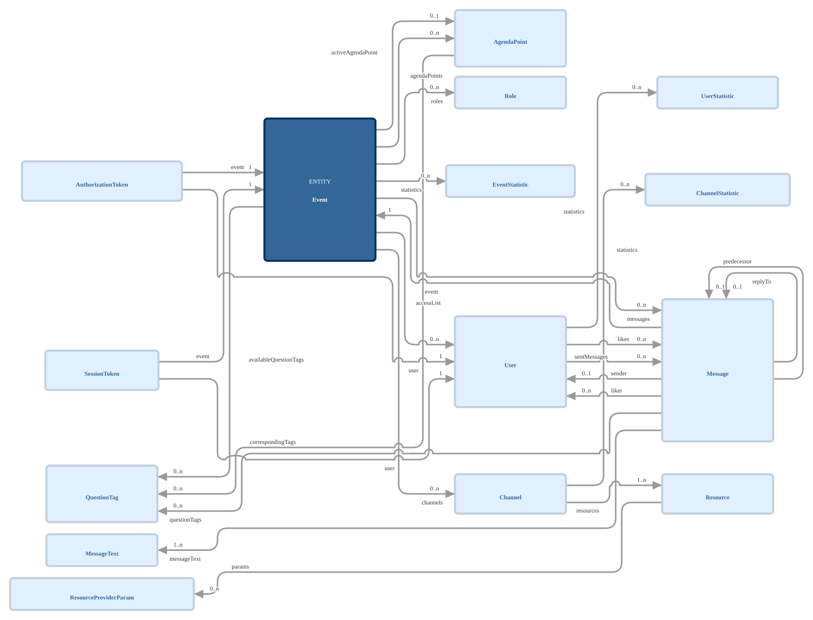

- [broadcast-hub](smp/broadcast-hub.txt):

  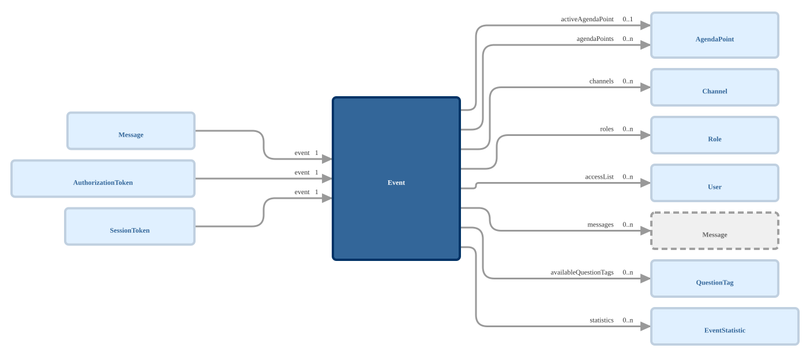

- [broadcast-grid](smp/broadcast-grid.txt):

  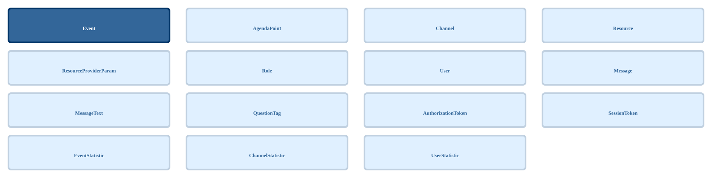

- [container-sample](smp/container-sample.txt) (nested containers):

  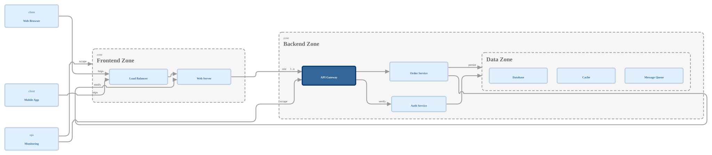

- [layout-bits](smp/layout-bits.txt) (bit fields):

  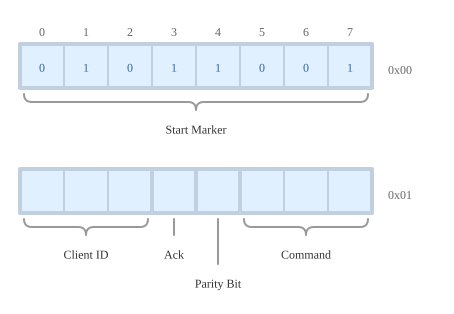

- [layout-bytes](smp/layout-bytes.txt) (byte fields):

  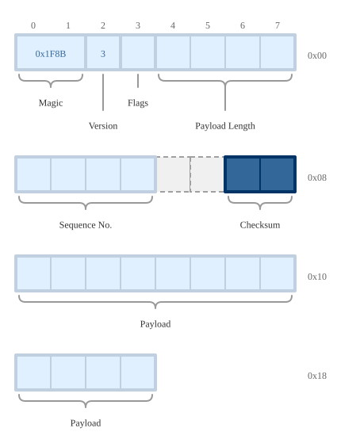

- [layer-sample](smp/layer-sample.txt) (layered architecture):

  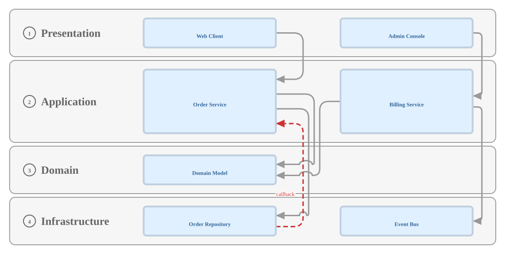

- [layer-groups](smp/layer-groups.txt) (layer groups, numbers, and node shapes):

  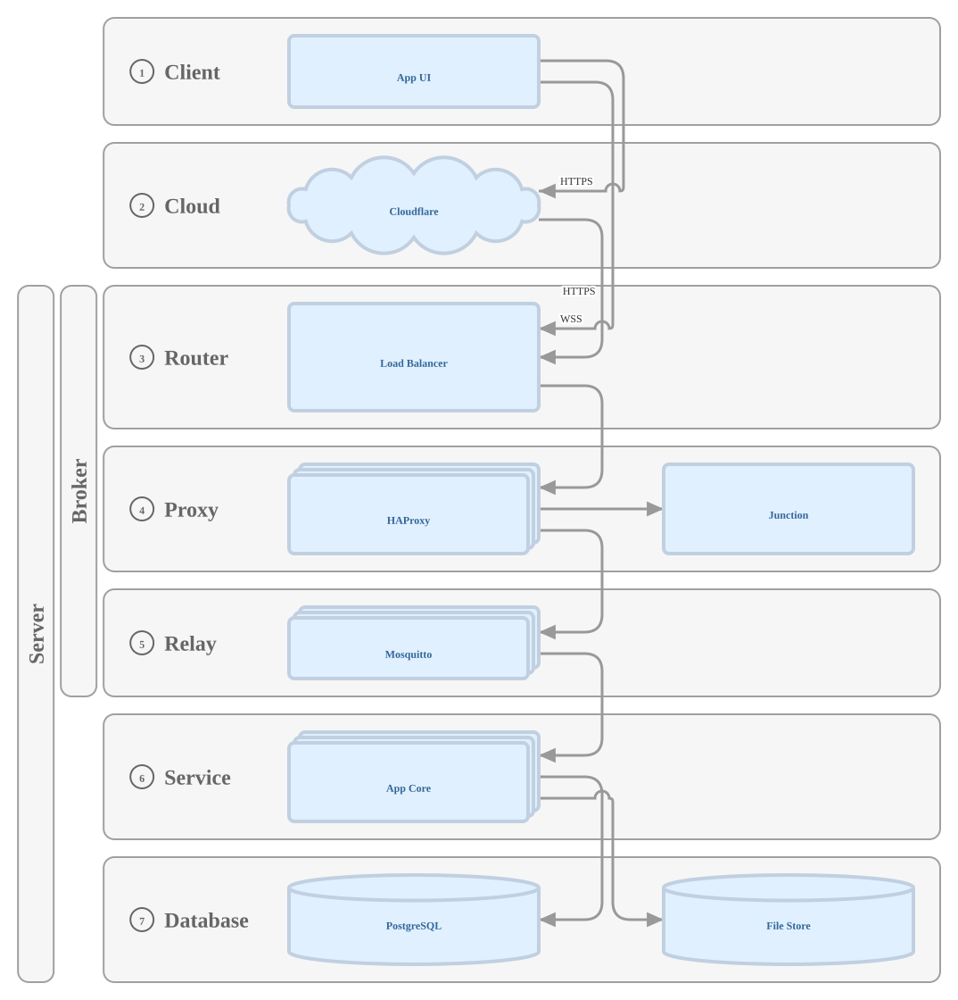

- [matrix-sample](smp/matrix-sample.txt) (dependency structure matrix):

  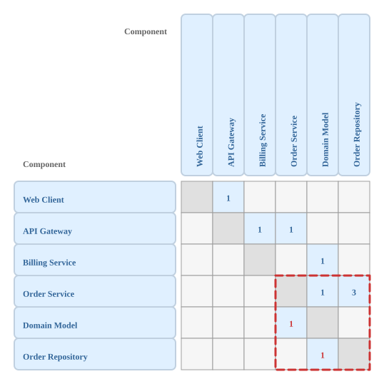

- [trace-sample](smp/trace-sample.txt) (traceability matrix):

  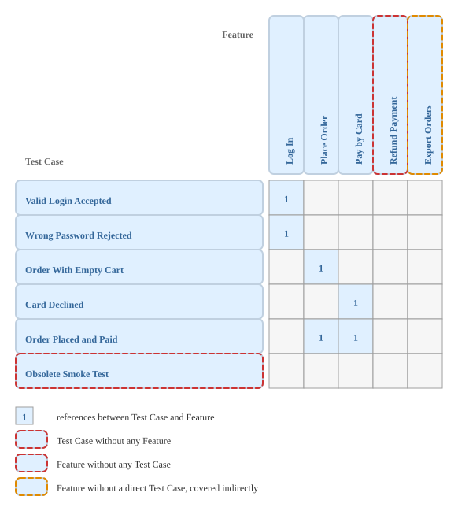

- [shape-sample](smp/shape-sample.txt) (node shapes):

  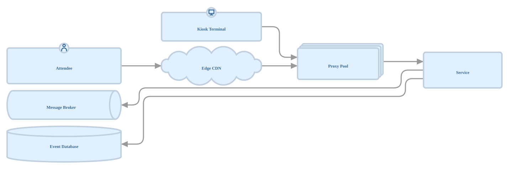

- [sequence-sample](smp/sequence-sample.txt) (sequence diagram):

  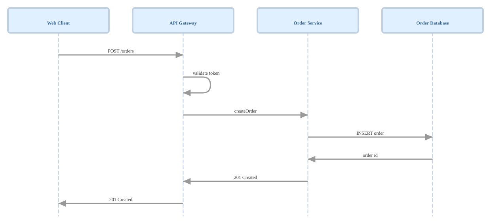

Playground
----------

See [playground.html](smp/playground.html) for a demo playground.

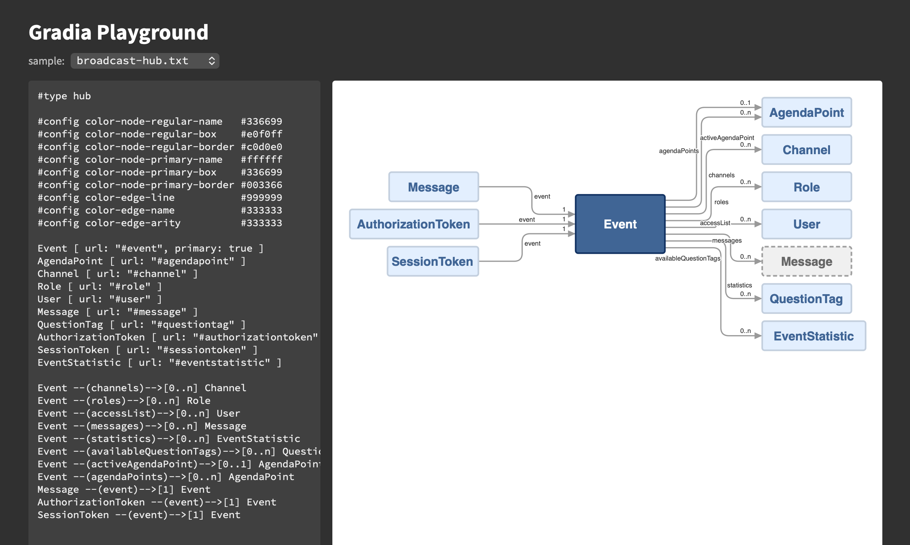

Installation
------------

```sh
$ npm install @rse/gradia
```

Usage
-----

```sh
$ gradia [-t graph|hub|grid|layout|layer|matrix|sequence] [-f <format>] [-c <name>=<value>] -o <file>.svg <graph>.txt
```

The diagram type is selected with the `-t` command-line option or, when
this is absent, by the `#type` directive inside the input, and defaults
to `graph`.

The output format is `svg:standalone` (a standalone SVG/XML document,
the default), `svg:embedded` (the SVG without the `<?xml?>` declaration,
for direct embedding into HTML), `url:xml` (a `data:image/svg+xml` URL
with URL-encoded XML), or `url:base64` (a `data:image/svg+xml` URL with
Base64-encoded XML).

MCP Service
-----------

```sh
$ gradia --mcp [-t graph|hub|grid|layout|layer|matrix|sequence] [-f <format>] [-c <name>=<value>]
```

With the `-m`/`--mcp` option, **Gradia** instead runs as a [Model Context
Protocol](https://modelcontextprotocol.io/) (MCP) service on stdio,
exposing a single tool `gradia_render` which renders a graph description
into an SVG diagram. The tool takes the arguments `input` (the graph
description), `type`, `format`, and `config` (an object of rendering
options), and returns the rendered SVG document or data URL as its text
result. Its description carries the entire input language grammar, so
an AI agent can author graph descriptions without further context. The
command-line options `--type`, `--format`, and `--config` act as the
defaults underlying the tool call arguments.

As the tool call arguments are treated as untrusted, the `config`
argument rejects the option `font-embed` and a `font-family` value
pointing to a WOFF2 file. Both remain available through the
(trusted) command-line options of the service.

Configure the service in an MCP client with:

```json
{
    "mcpServers": {
        "gradia": {
            "command": "npx",
            "args": [ "-y", "@rse/gradia", "--mcp" ]
        }
    }
}
```

Input Syntax
------------

The input is a plain-text graph description: one node/edge chain per
line, plus optional comments and rendering directives.

### Grammar

The following BNF grammar describes the input syntax. Non-terminals are
written as `<name>`, terminals as `"..."`, optional parts as `[ ... ]`,
repeatable parts as `{ ... }` (zero or more times), and alternatives are
separated by `|`.

```bnf
<graph>          ::= { <statement> | <newline> }
<statement>      ::= <node> { <edge> <node> } ( <newline> | <eof> )
<node>           ::= <atom> [ ":" <atom> ] [ <attributes> ]
<attributes>     ::= "[" <attribute> { "," <attribute> } "]"
<attribute>      ::= <atom> ":" <atom>
<edge>           ::= "--" [ "(" <edge-name> ")" "--" ] ">" [ "[" <edge-arity> "]" ]
<edge-name>      ::= <string> | <name-word>
<edge-arity>     ::= <string> | <arity-word>
<atom>           ::= <bareword> | <string>
<bareword>       ::= <bareword-char> { <bareword-char> }
<bareword-char>  ::= <char> - ( <whitespace> | "[" | "]" | "(" | ")" | "," | ":" | "\"" | ">" | "#" )
<name-word>      ::= <name-char> { <name-char> }
<name-char>      ::= <char> - ( <whitespace> | "(" | ")" | "\"" )
<arity-word>     ::= <arity-char> { <arity-char> }
<arity-char>     ::= <char> - ( <whitespace> | "[" | "]" | "\"" )
<string>         ::= "\"" { <string-char> } "\""
<string-char>    ::= ( <char> - ( "\"" | "\\" | <newline> ) ) | ( "\\" ( <char> - <newline> ) )
<comment>        ::= "#" { <char> - <newline> }
<directive>      ::= "#config" <whitespace> { <whitespace> } <option> <whitespace> { <whitespace> } ( <string> | <word> )
                   | "#type" <whitespace> { <whitespace> } <type>
<option>         ::= <letter> { <letter> | <digit> | "-" }
<type>           ::= "graph" | "hub" | "grid" | "layout" | "layer" | "matrix" | "sequence"
<word>           ::= <char> - <whitespace> { <char> - <whitespace> }
<newline>        ::= "\n"
<whitespace>     ::= " " | "\t" | "\r"
```

### Lexical Rules

- A `<bareword>` must not contain the character sequence `--` at any
  position, as `--` always starts an edge operator.

- An `<edge>` is a single lexical token: no whitespace and no comment is
  allowed anywhere inside it, especially not between `>` and `[`.

- Whitespace (except `<newline>`) is insignificant between all other
  tokens and never part of a token.

- A `<newline>` terminates a `<statement>`: statements cannot span
  multiple lines.

- A `<comment>` starts at an unquoted `#` and extends to the end of the
  line. Inside a `<string>`, `#` is an ordinary character.

- A `<string>` cannot span lines. Inside it, `\` escapes the following
  character (especially `\"` and `\\`).

- A `<directive>` is a `<comment>` which occupies its entire line and
  starts with the keyword `#config` or `#type`. For `#config`, the
  `<option>` has to be one of the recognized rendering options (see
  below). All other comments are ignored.

### Semantic Rules

- In `<node>`, the first `<atom>` is the node id and the optional
  `<atom>` after `:` is the displayed node label. Without a label, the
  id is displayed.

- A node can be referenced multiple times. All references address the
  same node and merge their label and attributes into it, with later
  values overriding earlier ones for the same attribute key.

- Nodes which are never part of an `<edge>` are rendered free-standing.

- In a chain `a --> b --> c`, each `<edge>` connects its immediately
  preceding and following node, i.e., the chain is equivalent to the
  two statements `a --> b` and `b --> c`.

- The `<edge-name>` is rendered as the label of the edge and the
  `<edge-arity>` as its cardinality label.

- Eight attribute keys are reserved and consumed by the renderer instead
  of being displayed as a regular `<key>: <val>` line (beside the ones
  the individual diagram types reserve, see below):

    - `url: <url>` renders the node box as a hyperlink. Only relative URLs
      and the schemes `http`, `https`, and `mailto` are honored; any other
      URL is silently dropped and the node box then simply stays unlinked,
    - `type: <name>` renders `<name>` as a smaller text above the node
      label inside the node box,
    - `primary: true` renders the node in the primary node colors
      (and, for diagram type `hub`, marks the single central hub node),
    - `group: <name>` places the node into the surrounding group box
      `<name>`,
    - `parent: <id>` nests the node into the container node `<id>` (a
      node which is implicitly declared if never referenced otherwise),
    - `container: <type>` marks the node as a container whose members
      are laid out with the diagram type `<type>` (`graph`, `hub`, or
      `grid`), even if it has no members at all,
    - `order: <number>` places the node explicitly (see below),
    - `shape: <shape>` draws the node box with another outline (see
      below).

- A `graph` (a `graph` container level, too) with at least one node
  carrying an `order` attribute is laid out in that explicit order
  instead of by the layered algorithm: the distinct order values become
  the rows, top-down in ascending order, the nodes of one value fill
  their row left-to-right in declaration order (wrapped into further
  rows beyond `graph-columns-max` nodes), and the nodes without an order
  follow in the trailing rows. A `grid` places its tiles in the order of
  the attribute, too, the tiles without one trailing. An invalid value
  is ignored.

- A node cannot be a member of more than one group. As soon as at least
  one node carries a `group` attribute, all nodes without one implicitly
  belong to the group `default`, and every edge has to stay within a
  single group. A nested node belongs to the group of its outermost
  container.

- A node referenced as the `parent` of another node is a container: it
  is rendered as a dashed grey box surrounding its members instead of as
  a node box, with its label, `type`, and `url` in the box head (its
  remaining attributes are not rendered). Containers nest to any depth,
  but a node cannot be a member of more than one container, and cannot
  be nested into itself.

- The members of a container are laid out as a diagram of their own,
  with the diagram type of the enclosing level unless overridden by
  `container: <type>`, and the container then takes part in the layout
  of the enclosing level as a single box. Edges may connect any two
  nodes, across container boundaries and to container nodes themselves,
  except a container with one of its own members. An edge crossing the
  boundary of a container laid out as `graph` is routed through the box
  border to the inner node (entering on the west and leaving on the east
  side, and where other nodes lie between the inner node and the border,
  around them through the gutter below, passing the border at the
  height of that gutter), while an edge crossing the boundary of a
  container laid out as `hub` or `grid` ends at the box border instead.

- The attribute `shape: <shape>` draws the node box with another
  outline, keeping its colors and its text, where the outline claims
  the additional room it needs around the text: `box` (the
  default), `database` (a cylinder), `queue` (a lying cylinder), `cloud`
  (a cloud), `stack` (the box stacked onto two copies of itself, for
  several instances), `person` (a box with a person badge on its top
  border), or `device` (a box with a device badge), where an unknown
  shape is ignored.

- All remaining attributes are displayed as `<key>: <val>` lines inside
  the node box.

### Diagram Type Constraints

The diagram type `graph` imposes no constraints on the topology: it
accepts self-loops and free-standing nodes alike, and hence is the safe
choice whenever the topology is not known to fit `hub` or `grid`.

The diagram type `hub` rejects the input with an error unless all of the
following conditions hold:

- Exactly one node carries the attribute `primary: true`.

- Every edge either points to or originates from that primary node. An
  edge between two non-primary nodes is rejected.

- Every non-primary node is an input or an output of the primary node,
  i.e., no node is free-standing.

A node which is both an input and an output of the primary node is placed
twice, once in the input column and once in the output column. The second
placement is rendered as a dashed "ghost" box, colored by the
`color-node-ghost-*` options.

A self-loop on the primary node is unrolled: the primary node is placed a
second time on top of the output column, as the target of the self-loop.
This second placement is rendered as a dashed "self" box, colored by the
(darker grey) `color-node-self-*` options.

The diagram type `grid` rejects the input with an error as soon as the
graph contains at least one edge.

The diagram type `layout` rejects the input with an error as soon as the
graph contains at least one edge or one container. Every node is a field
of the binary structure and has to carry the attributes `offset` and
`size` (non-negative and positive integers, decimal or `0x` hexadecimal),
both counted in cells of `layout-cell-bits` bits each, where a `size` of
`*` denotes a variable size, drawn up to the end of its row and marked
as continuing by a trailing `...` of its label. The fields are drawn in
rows of `layout-row-cells` cells below a ruler of the cell numbers, a
field exceeding its row continues in the next one, overlapping fields
are rejected, and the cells between the fields are drawn as dashed gaps.
A layout spans at most 4096 cells and `layout-row-cells` is at most
256, as every cell becomes several elements of the drawing.
Every field is labeled below its cells through a brace (or, for a single
cell, a tick), where the labels of narrow neighboring fields stagger
downwards, connected by a leader line. The optional attribute `value`
shows a fixed value inside the cells: one character (code point) per
cell, if it has exactly as many characters as the field has cells (e.g. the bits of a
marker), else once across the merged cells of the field (e.g. a magic
number). The attributes `url` (on the label) and `primary` (the primary
cell colors) are honored, and the `group` attribute stacks several
structures as group boxes, while all other attributes are ignored. The
offset of every row is shown right beside it, in hexadecimal bytes
(or in bits, where a row does not start on a byte boundary).

The diagram type `layer` lays out a layered architecture and rejects
the input with an error as soon as the graph contains a container. The
attribute `layer: <name>` assigns a node to a layer, the layers stack
top-down in the order of their first appearance as bands spanning the
whole diagram (colored by the `color-container-*` options, the layer name
left of its nodes), and the nodes of a layer fill its band
left-to-right (wrapped beyond `graph-columns-max` nodes), while the nodes
without a layer trail outside of any band. An edge pointing from a lower
layer to a higher one, i.e. against the layering, is drawn dashed in the
`color-mark-violation` color, as it marks a violation of the layering.
The attribute `layer-group: <path>` assigns the layer of a node to nested
groups ("/"-separated, outermost first, e.g. "Server/Broker"), which are
drawn as columns left of the bands, spanning the bands of their layers,
with their names running upwards (the layers of a group are kept
together, and all nodes of a layer have to name the same path), and
the option `layer-numbered` numbers the layers top-down. All node boxes
take the width of the widest one and the boxes of a layer the height of
the highest one, so the boxes line up across the layers.

The diagram type `sequence` draws a sequence diagram and rejects the
input with an error as soon as the graph contains a container: the nodes
(in declaration order, or in the order of their `order` attributes) are
the participants, drawn as regular node boxes side by side (all of the
size of the largest one) on top of their dashed lifelines, and the edges
are the messages, drawn as regular edges with their names and arities
between the lifelines, top-down in declaration order, where an edge from
a node to itself loops on its own lifeline. The option
`sequence-message-gap` sets the vertical distance of the messages.

The diagram type `matrix` draws a dependency structure matrix (DSM) and
rejects the input with an error as soon as the graph contains a
container. The nodes are both its rows and its columns (in declaration
order, or in the order of their `order` attributes), the row and
column headers carrying the node labels in boxes of the node box colors
(linked through `url`), lying and upright. A matrix reads from a row to
its columns: the cell of row X and column Y carries the number of edges
from X to Y (their summed numeric arities), i.e. how often X depends on Y, the diagonal is shaded, and every cycle, i.e. every set of
nodes reaching each other through their edges, is moved into
consecutive rows and outlined as a dashed block on the diagonal, with
the numbers of its edges in the `color-mark-violation` color.

As soon as a node carries the attribute `axis: column`, the `matrix` is a
traceability matrix instead: the `axis: column` nodes are its columns and all
other nodes its rows, a cell counts the edges between its row and its
column in either direction (as a trace may be recorded on either side,
e.g. a test case referencing the requirement it verifies), there is no
diagonal and no cycle, and a row or column without any entry is marked
as a gap by a header outlined dashed in the `color-mark-violation` color,
or, if the node carries the attribute `trace: indirect` (as it relates to
the other side indirectly only, e.g. a test case verifying a rule which
constrains a requirement), in the `color-mark-warning` color.

In both forms the type shared by all rows, and the one shared by all
columns (their `type` attributes), become their titles in the corner
above the row headers and left of the column headers.

The diagram types marking violations or gaps (`layer` and `matrix`) explain the
marks actually shown in a legend below the diagram (plus, for a
`matrix`, the meaning of its cell numbers), which the `legend` option
disables and the `legend-*` options reword (e.g. to localize them),
where `{row}` and `{column}` stand for the row and column titles of a
matrix, and `{item}` and `{other}` for the title of the marked side and
the one of the other side (falling back to the texts of `legend-row`
and `legend-column`).

As the groups of a grouped graph, and the members of every container,
are laid out individually with the selected (or, for a container, the
annotated) diagram type, these constraints apply to every single group
and container level, with the edges crossing a container boundary
counting at the level they are lifted to (the boundary-crossing edges of
a `graph` container additionally count inside it, from the boundary to
the inner node). For the type `hub` this especially means that every
group and every `hub` container needs its own primary node.

### Directives

A `#type` directive sets the diagram type (`graph`, `hub`, `grid`, `layout`, `layer`, `matrix`, or `sequence`),
which otherwise is settable through the `-t`/`--type` command-line
option (which takes precedence). The last occurrence wins and an invalid
type is silently ignored. Without both, the type defaults to `graph`.

A `#config` directive sets one of the rendering options, which otherwise
are settable through the corresponding `--config <option>=<value>`
command-line options (`font-embed` being command-line only, see below).
The recognized options, and their default values, are:

```
font-family                Helvetica    size-node-width-min        220
font-embed                 false        size-node-width-max        0
color-node-regular-name    #336699      size-node-height-scale     2.25
color-node-regular-box     #e0f0ff      size-edge-corner-radius    20
color-node-regular-border  #c0d0e0      size-edge-hop-radius       8
color-node-primary-name    #ffffff      size-edge-track-gap        12
color-node-primary-box     #336699      size-edge-track-gap-min    8
color-node-primary-border  #003366      size-edge-port-gap         24
color-node-ghost-name      #666666      group-box-padding          30
color-node-ghost-box       #f0f0f0      group-box-gap              40
color-node-ghost-border    #a0a0a0      container-box-padding      30
color-node-self-name       #444444      graph-columns-max          4
color-node-self-box        #e0e0e0      graph-channel-width-max    140
color-node-self-border     #707070      graph-channel-width-min    24
color-group-name           #6699cc      graph-gutter-height-max    90
color-group-box            #f4f8fc      graph-gutter-height-min    20
color-group-border         #c0d0e0      graph-node-separation      30
color-container-name       #666666      graph-rank-separation      60
color-container-box        #f6f6f6      graph-node-degree-max      3
color-container-border     #a0a0a0      hub-channel-width-max      340
color-edge-line            #999999      hub-channel-width-min      240
color-edge-name            #333333      hub-node-gap               20
color-edge-arity           #333333      hub-node-degree-max        3
color-edge-halo            #ffffff      hub-node-count-max         0
color-mark-violation       #cc3333      grid-columns-max           4
color-mark-warning         #e08a00      grid-columns-min           3
size-font-node             30           grid-gap-horizontal        40
size-font-type             16           grid-gap-vertical          20
size-font-prop             22           grid-node-width-equal      true
size-font-edge             16           grid-node-height-equal     true
size-font-arity            16           layout-row-cells           8
size-canvas-margin         40           layout-cell-bits           8
legend                     true         layout-cell-size           44
                                        layer-numbered             false
                                        matrix-cell-size           44
                                        sequence-message-gap       56

legend-row                 "row"
legend-column              "column"
legend-count               "references from {row} to {column}"
legend-trace               "references between {row} and {column}"
legend-cycle               "cyclic dependency"
legend-upward              "dependency against the layering"
legend-gap                 "{item} without any {other}"
legend-indirect            "{item} without a direct {other}, covered indirectly"
```

The `size-*`, `group-*`, `container-*`, `graph-*`, `hub-*`, `grid-*`,
`layout-*`, `layer-*`, `matrix-*`, and `sequence-*` options control the
rendering geometry (text font sizes, canvas margin, node box sizing,
edge routing, group and container box spacing, and the
per-diagram-type layout) and take non-negative numbers, except the
booleans `grid-node-width-equal`, `grid-node-height-equal`, and
`layer-numbered`. The boolean `legend` enables the legend below a
diagram marking violations or gaps, and the `legend-*` options are the
non-empty texts of its entries.

The `size-font-*` options control the font sizes of the node names
(`size-font-node`), the node types (`size-font-type`), the node
properties (`size-font-prop`), the edge names (`size-font-edge`), and
the edge arities (`size-font-arity`). They are geometry options, as they
size the node boxes and the channels the edge labels land in: the line
heights inside a node box, the head of a container box, and the width
demand of a channel all track their font size.

The `size-node-width-max` option additionally enables the word-wrapping
of the node box texts: given a positive value, the node name, its type,
and its attribute lines are greedily broken at whitespace so that the
node box stays within the given width and grows in height instead. The
value `0` disables the wrapping entirely and hence lets a node box
become as wide as its longest text. A single word wider than the
maximum is never broken and still widens the box beyond the maximum.

The `group-box-padding` and `container-box-padding` options control the
inner padding of the group and container boxes around their content.
For a `graph` container, the content additionally includes the
boundary channels along its west and east sides, through which the
edges crossing the container boundary reach the inner nodes, sized
like all channels by the edges routed through them.

The `size-edge-port-gap` option controls the distance of the edge
attachment ports along a node side, and hence the vertical distance of
the parallel edges and their labels. A node box grows in height until
it holds all of its ports at that distance, so the edges of a node stay
readably apart however short its textual content is, and a node side
carrying more edges than `graph-node-degree-max` or
`hub-node-degree-max` grows by this very distance per additional edge
on top of that. In a diagram whose edges carry arities, the distance is
raised to what those labels demand, as an arity sits beside its own
edge line and has to stay clear of the arrow head above it. Only the
fixed-size box of a container placeholder cannot grow and hence packs
its ports closer together instead.

The `graph-channel-width-*` and `graph-gutter-height-*` options control
the spacing of a `graph` diagram: its inter-column channels and
inter-row gutters are sized by the edges routed through them and by the
edge labels landing inside them -- a channel by the widest label demand
it has to hold (an edge name placed along it, or an edge arity set back
from its arrow head), a gutter by one text line per edge name placed
along its run. The `-min` options raise the result, so that even an
unlabeled diagram can be spaced out, while the `-max` options cap it, so
that neither many parallel edges nor a long label can push the nodes
apart without bound (except for the crowded channels and gutters, see
below). A used channel always keeps its outermost edge tracks so far
from the node boxes beside it, that an arrow head plus the corner in
front of it fit in between, so neither a corner nor the hop of a
crossing edge touches an arrow head.

The `size-edge-track-gap` option controls the distance of the parallel
edge tracks within a channel or gutter. A channel or gutter whose tracks
do not fit at this distance into its capped width or height (by
`graph-channel-width-max` and `graph-gutter-height-max` in a `graph`
diagram, and by `hub-channel-width-max` in a `hub` diagram) is crowded
and bundles its edges: the edges leading to the same node side (or else
coming from the same node side) share one common track, which their
individual stubs join and leave at junctions marked by a dot. The
remaining tracks are spread at the `size-edge-track-gap` distance where
they fit, but never closer than the `size-edge-track-gap-min` distance,
so the parallel edge lines always stay visibly apart. Hence, a crowded
channel or gutter of a `graph` diagram is sized by its bundled tracks
instead of by its edge count, which may exceed its `-max` option, and a
crowded channel of a `hub` diagram grows beyond `hub-channel-width-max`
if its bundled tracks do not fit even at the minimum distance. All
channels and gutters which are not crowded stay unaffected.

In a `graph` diagram (a `graph` container level, too) whose nodes end up
in a single column, the container boxes are widened to the widest one,
so the stacked boxes line up: their content stays centered, and their
height remains the one of their content. With more than one column,
every container box keeps the width of its own content.

The `hub-node-count-max` option controls the wrapping of the input and
output column of a `hub` diagram: given a positive value, a column of
more nodes than this wraps into two staggered sub-columns, whose nodes
alternate between the outer sub-column and the inner one, with every
outer node vertically centered onto a gap between two inner nodes,
through which its edges reach the primary node. This trades nearly
half of the height of a large diagram for additional width. The option
decides for the larger of the two columns alone, as the height of the
diagram follows that one: the node count of its tallest resulting
(sub-)column implicitly caps the smaller column, which hence wraps
exactly if that lowers the height of the diagram. The value `0`
disables the wrapping entirely.

The `grid-columns-min` and `grid-columns-max` options control the column
count of a `grid` diagram, which by default is derived from the node
count as a roughly square grid: `grid-columns-min` raises the derived
count, so that a few nodes still share a single row instead of being
stacked, while `grid-columns-max` caps it, so that larger diagrams grow
in height only. The column count never exceeds the node count and the
maximum always wins over the minimum.

The `layout-row-cells`, `layout-cell-bits`, and `layout-cell-size`
options control a `layout` diagram: the number of cells per row, the
number of bits a cell stands for (usually `1` for bit fields or `8` for
byte fields, which decides the offset shown beside every row), and the
width and height of a cell. The cells, values, ruler, braces, and labels
are drawn in the colors and font sizes of the node boxes, node types,
node properties, and edges, so a `layout` diagram blends into the other
diagram types.

The `grid-node-width-equal` and `grid-node-height-equal` options control
the tile sizes of a `grid` diagram: the value `true` forces all node
boxes to the width of the widest one (or the height of the tallest one)
and hence yields a strictly regular grid, while `false` lets each column
become only as wide as its own widest node box (or each row only as tall
as its own tallest node box), with the tiles left-aligned within their
column (or top-aligned within their row). A nested container box takes
part in the width unification only, as its height is the one of its
content: it never grows to the height of the tallest tile of its row,
but keeps its row as tall as itself.

The `font-family` and `color-*` options are embedded directly into the
generated SVG. When such an option is *not* explicitly configured, the
SVG references the CSS custom property `--gradia-<option>` (definable by
the embedding document, e.g. for the `svg:embedded` output format) and
falls back to the built-in default. An explicitly configured value is
hard-coded into the SVG instead. The resulting precedence is: first
`#config`/`--config`, then the CSS custom property `--gradia-<option>`,
and finally the built-in default.

The `size-font-*` options are embedded into the generated SVG, too, but
as they also sized the layout, the SVG always references the CSS custom
property `--gradia-<option>` and falls back to the *effective* value
(configured or default). An override at display time hence retains the
layout of the configured size and should stay close to it.

The styling is not repeated on every element of the generated SVG, but
declared once as CSS classes in a `<style>` element, which the elements
reference. A class is named `gradia-<digest>` after the digest of its
own declarations, so equal declarations always yield the very same
class. As the class names are global once multiple diagrams are embedded
into the very same document, the embedding document can hence strip the
`<style>` elements off the diagrams and declare the union of their
rules (one per line) a single time on its own.

The `font-family` option is either a built-in font family, a plain font
family name, or the path to a WOFF2 file. The only built-in font family
is `Source Sans 3`, shipped as a variable WOFF2 file by the NPM
dependency [source-sans](https://github.com/adobe-fonts/source-sans),
and hence the only font which can be embedded without an external font
file:

```sh
$ gradia -c font-family="Source Sans 3" -c font-embed=true -o graph.svg graph.txt
```

The option `font-embed`, and a `font-family` value pointing to a WOFF2
file, are intentionally rejected in directives, as the input is treated
as untrusted. Both are available on the command line only.

### Example

```
#type   graph

#config color-node-primary-box  #336699
#config color-edge-line         #999999

Animal: animal [ type: "abstract class", kind: base, url: "#animal", primary: true ]
Dog: dog
Cat: cat

Dog --(isa)--> Animal
Cat --(isa)--> Animal
"Pet Owner" --(owns)-->[0..*] Dog --(chases)-->[0..n] Cat
```

License
-------

Copyright &copy; 2026 Dr. Ralf S. Engelschall (http://engelschall.com/)<br/>
Distributed under MIT license (https://spdx.org/licenses/MIT.html)

